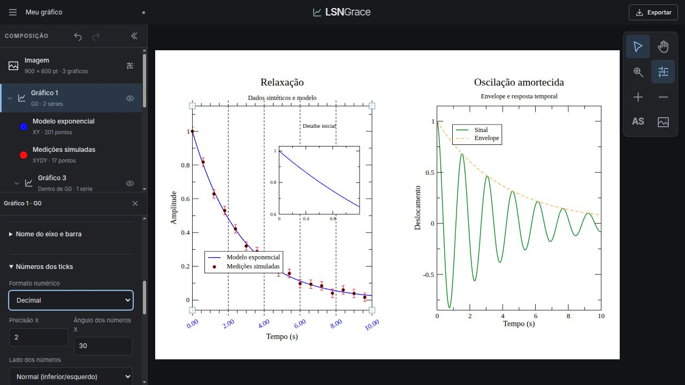

# Edição automática e personalização de eixos

Verificação em 24/11/2026 com Grace 5.1.25.

## Alterações

NumberField passou de confirmação no Enter/blur para aplicação automática de valores válidos após 180 ms sem digitação. O campo conserva foco e texto durante as atualizações. Valores incompletos ou inválidos não entram no documento; incompatibilidades são indicadas no próprio campo, sem descartar a figura. Blur confirma o valor válido pendente e recupera o valor aceito quando a entrada é inválida.

Um contexto síncrono identifica cada sessão de foco numérica. O histórico agrupa seus valores aceitos, preservando o estado inicial para Desfazer. Undo/Redo e carregamento de outro documento interrompem o agrupamento.

O inspetor dos eixos X/Y usa cinco grupos expansíveis: escala/intervalo, nome/barra, números, marcas/grades e posicionamento. Os controles cobrem visibilidade independente, formato/precisão dos números, tipografia e cores, ângulo, lados, prefixos/sufixos, omissão e alternância de rótulos, espaçamento/subdivisões, tamanhos e estilos dos ticks, grades, eixo na origem e deslocamentos.

Os campos opcionais de origem, deslocamento, skip e stagger foram adicionados à tabela compartilhada de parser/serializador AGR. Rascunhos v1 antigos continuam válidos. A omissão de campos opcionais não mascara campos obrigatórios ausentes. A prévia rápida de zoom é evitada para características avançadas que ela não representa; o resultado continua sendo o SVG/PNG nativo.

## Verificação

- **100 testes aprovados**, incluindo round-trip das opções de eixo, rascunhos antigos, agrupamento de Undo, rejeição atômica de valores inválidos e verificação de campos obrigatórios.
- **Integração com Grace:** SVG, PNG e AGR de um gráfico com eixo na origem, offsets, direção e estilo de ticks, fonte, formato decimal, ângulo de 30°, prefixo/sufixo, omissão e alternância de rótulos. Exportação sem avisos e parâmetros preservados após salvar pelo programa original.
- **Navegador, sem Enter nem blur:** o limite X máximo mudou de 10 para 12 e depois 14; o SVG nativo passou a exibir esses valores enquanto o campo continuou focado. Um único Desfazer restaurou 10.
- Um X mínimo de 20, incompatível com X máximo de 10, permaneceu marcado como inválido enquanto o campo estava focado; nenhuma tela de erro ou mensagem de erro global substituiu a figura.
- Números do eixo em decimal com precisão 2, azul e rotação 30° foram confirmados no SVG: texto `2.00`, preenchimento `#0000FF` e matriz de rotação correspondente. Também foram testados ticks para fora, três subdivisões e grade principal tracejada.
- Build TypeScript/Vite e formatação aprovados. A checagem de navegador usou localhost, separada do rascunho em 127.0.0.1.

