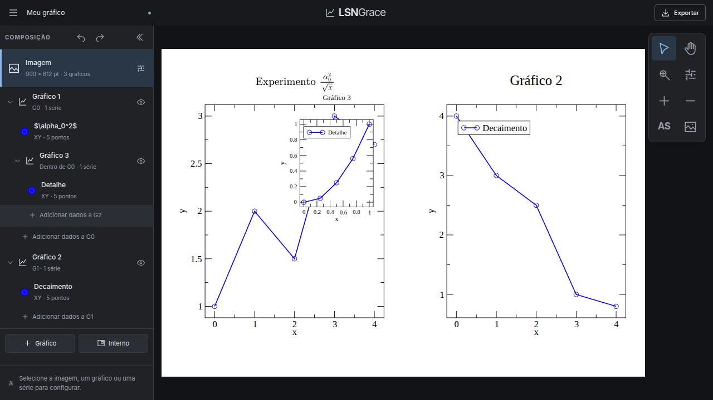
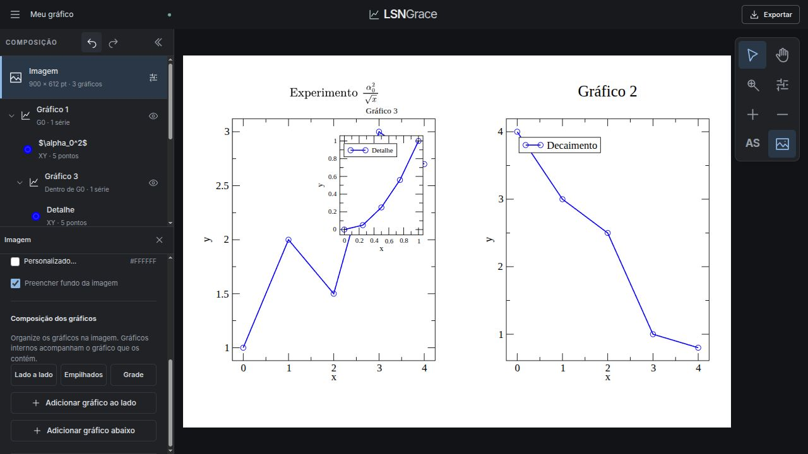

# Imagem, gráficos e séries

Verificação em 24/11/2026 com Grace 5.1.25.

## Interface

A árvore lateral tem Imagem como raiz, gráficos G0…Gn e suas séries. Ela permanece visível durante a edição das propriedades. Gráficos totalmente contidos em outro viewport aparecem como filhos desse gráfico; a relação é derivada da geometria nativa do AGR. Áreas iguais não criam ciclos. Quando há vários possíveis pais, é usado o menor gráfico que contém o filho.

Imagem oferece tamanho em pontos, orientação, fundo e layouts lado a lado, empilhado e grade. Cada gráfico oferece posição e dimensões como percentuais da imagem, além do inspetor existente de eixos, textos, escalas, legenda e séries. Os controles permitem acrescentar gráficos independentes ou internos, importar dados para um gráfico específico, ocultar gráficos/séries e remover um gráfico com Undo/Redo.

A barra do canto superior direito tem oito botões em quatro linhas e duas colunas. Os botões medem 44 × 44 px no desktop, os ícones medem 25–27 px e o autoscale usa AS. A área da imagem reserva espaço para essa barra, evitando que as ferramentas cubram o desenho. Em telas estreitas, a barra fica acima da área da imagem.

## Composição e compatibilidade

O modelo continua Page → Graphs → Sets e o motor permanece o Grace original. Adicionar um gráfico independente organiza os painéis em uma linha ou coluna; gráficos internos são preservados dentro de seus pais. Alterar um viewport transforma também seus gráficos internos e legendas em coordenadas view, sem modificar dados ou limites world. Legendas em coordenadas world mantêm esses valores.

O redimensionamento da imagem mantém as posições relativas dos viewports, legendas view e anotações modeladas. Diretivas legadas não modeladas continuam preservadas como texto original. Alterações de composição e remoções entram no histórico. O primeiro gráfico vazio é recriado ao remover o último gráfico.

## Evidência

- 81 testes automatizados aprovados: composição, relação de contenção, layouts, movimento em conjunto, compartilhamento de dados, troca de orientação, round-trip AGR e remoção com Undo/Redo, além da suíte anterior.
- Grace real: composição com dois painéis independentes e um gráfico interno exportada para SVG, PNG e AGR sem avisos. Verificados tamanho da página, títulos, séries, dados, viewports e reconstrução da hierarquia após salvar pelo motor. Valores numéricos usam a tolerância de ponto flutuante adotada nos testes nativos.
- Navegador: importação de cinco pontos no segundo gráfico e de outros cinco no gráfico interno, inspeção da imagem, mudança da largura para 900 pt, layout empilhado e Desfazer restaurando exatamente os retângulos anteriores.
- Medição DOM: barra com duas colunas de 44 px; imagem sem interseção com a barra; painel de propriedades sem rolagem horizontal.
- Build TypeScript/Vite e formatação aprovados.

O teste de navegador usou a origem localhost, separada do rascunho da origem 127.0.0.1.

