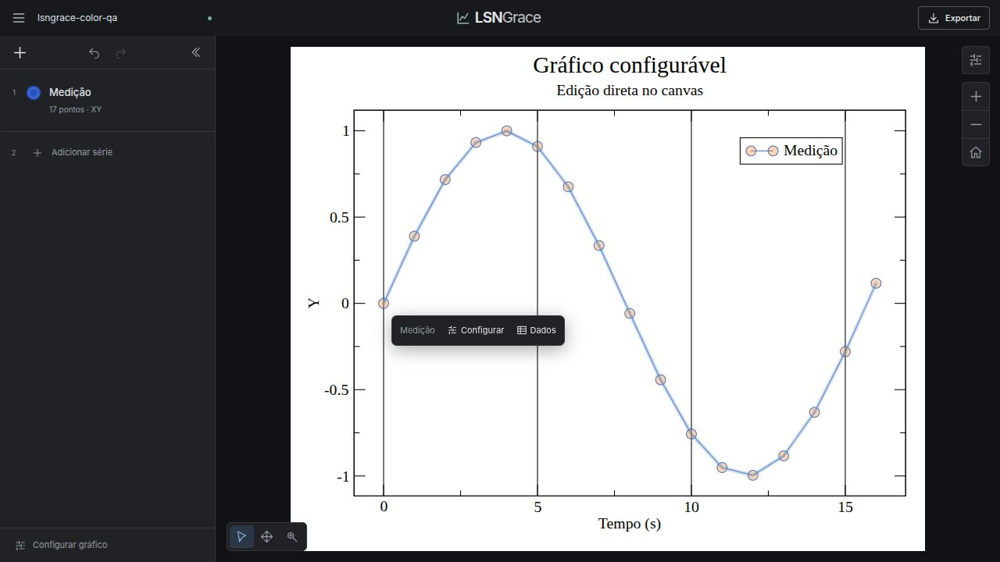
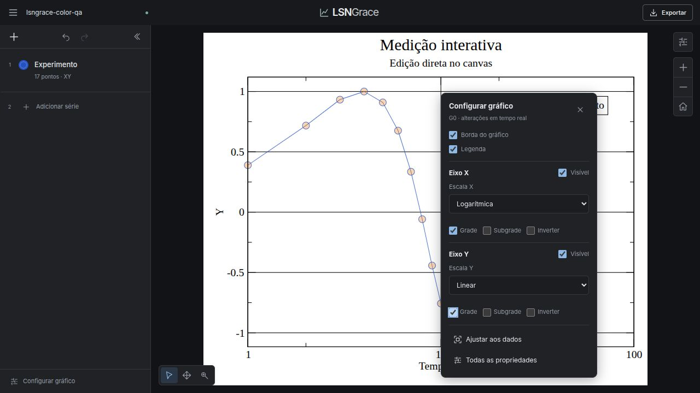

# Edição contextual do gráfico

## Uso

- Passe o mouse sobre uma curva, título, subtítulo, legenda, eixo ou nome de eixo: o elemento recebe realce e um atalho **Configurar**.
- Nas curvas, o atalho **Dados** abre diretamente o editor da série correta. **Configurar** e duplo clique abrem o estilo da série.
- Clique nos textos, eixos ou legenda para abrir o inspetor já no campo correspondente. O painel apresenta as opções do elemento; **Ver todas as propriedades** retorna à configuração completa.
- A legenda continua podendo ser arrastada. Um arraste não abre a edição por engano.
- Clique com o botão direito dentro da figura para abrir **Configurar gráfico**: borda, legenda, visibilidade dos eixos X/Y, escalas linear/logarítmica/recíproca, grades principal/secundária, inversão e ajuste automático.
- **Shift+F10** com foco no gráfico abre o mesmo menu. **Esc** ou clique fora fecha o menu. Os elementos também podem receber foco por Tab e ser configurados com Enter/Espaço.

## Estado e precisão

As configurações editam os campos existentes do Scene Graph, com Undo/Redo e serialização AGR. Abrir menus, passar o mouse e selecionar elementos não criam revisões do documento. Mudanças inválidas de escala são rejeitadas antes de alterar o gráfico; a validação do store mantém a revisão anterior.

Os alvos dos textos SVG são medidos a partir da geometria exibida pelo Grace, incluindo fonte, tamanho e enquadramento. As medições ocorrem apenas quando o SVG ou o enquadramento muda, não a cada movimento do mouse. Prévia PNG e textos científicos segmentados usam regiões estimadas. A camada nativa permanece memoizada e os alvos das curvas continuam reutilizando a geometria de seleção.

## Verificações

- 66 testes passaram, incluindo configuração de borda, visibilidade, grade, inversão, legendas, round-trip AGR, domínios de escala e Undo/Redo sem duplicar os dados.
- `npm run test:native`: o Grace real desenhou e salvou um gráfico sem borda, com eixo Y oculto, X logarítmico e grades principal/secundária; os parâmetros foram recuperados do AGR salvo.
- No navegador: menu de botão direito, borda ligada/desligada, ocultar/restaurar Y, grades, escala X logarítmica e retorno a linear.
- Nomes dos eixos e textos abriram os campos corretos. A verificação dos cinco alvos de título, subtítulo, X, Y e legenda confirmou que continham integralmente os textos nativos exibidos.
- Passar pela curva revelou **Configurar/Dados**; **Dados** abriu os 17 pontos da série de teste. Legenda e título foram editados na figura nativa.
- Shift+F10 abriu o menu e Esc fechou. O painel contextual do nome Y mostrou a escala Y e manteve X oculto. Sem erros no console.

