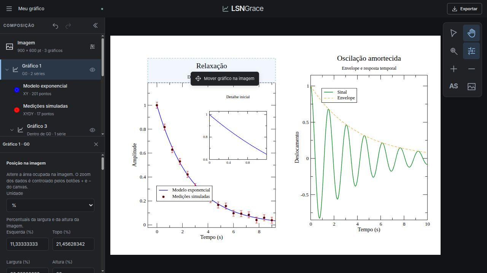
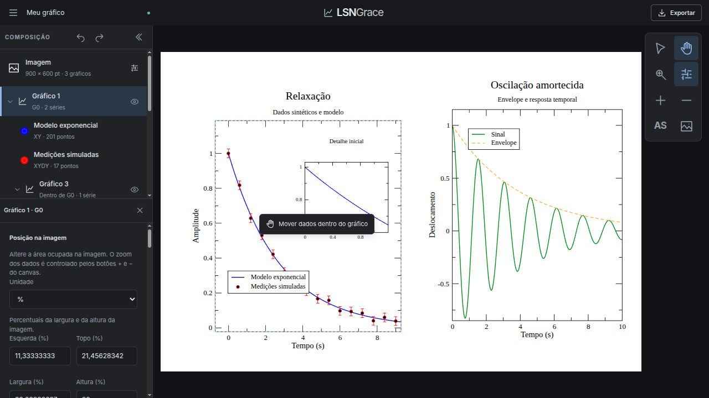
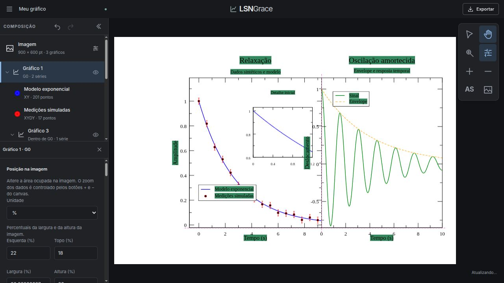

# Mão: pan e posição do gráfico

Verificação em 24/11/2026.

A mão tem destinos separados, com hover e dicas explícitas: área dos dados para pan, faixa superior do título/subtítulo para mover o gráfico na imagem e legenda para movê-la independentemente. A área interna recebe contorno no hover; a faixa superior recebe contorno e fundo suaves.

O movimento da posição usa deslocamento relativo e guias inteligentes de bordas/centros da página e dos demais gráficos visíveis. Gráficos internos que acompanham o movimento são excluídos das referências para evitar atração por si mesmos. Ctrl/Cmd desativa o encaixe. A câmera permanece na página e o resultado é confirmado como uma operação de histórico. Escape cancela.

A camada temporária permite translação sem redimensionamento. Os textos e a legenda reaproveitam os vetores nativos com a mesma translação; o Grace produz o resultado final. Durante os gestos, o desenho SVG não seleciona texto, inclusive enquanto o motor está atualizando.

## Verificação

- **104 testes aprovados**, incluindo distinção entre pan e translação, limites/dados preservados, compartilhamento das linhas de dados, movimento em conjunto de gráficos internos e legendas view, encaixes, posicionamento livre e rejeição de resize na prévia de translação.
- No navegador, a faixa superior de G0 mostrou **Mover gráfico na imagem**, com destaque ativo. A área interna mostrou **Mover dados dentro do gráfico**, com contorno ativo.
- Arrastar o cabeçalho deslocou G0 de (72, 108) pt para (102, 128,737700491) pt; o gráfico interno acompanhou o mesmo deslocamento. Os limites continuaram [0, 10, −0,06, 1,15].
- Arrastar por dentro manteve exatamente os retângulos dos gráficos e alterou apenas world para aproximadamente [−0,71508, 9,28492, −0,02198, 1,18802].
- Um segundo arraste superior encaixou a borda direita de G0 na borda esquerda de G1, em X = 546 pt, e a base em Y = 504 pt. As duas guias foram observadas no SVG da interface; os limites dos dados permaneceram iguais.
- O teste utilizou a origem localhost, separada do rascunho em 127.0.0.1. Build TypeScript/Vite e formatação aprovados.

