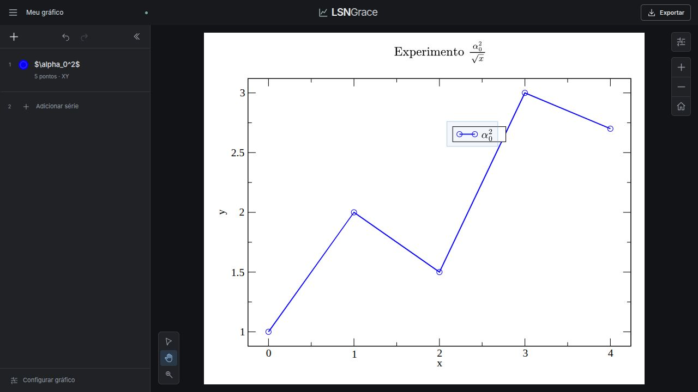

# Navegação, legenda e LaTeX

Verificação em 24/11/2026 com Grace 5.1.25.

## Mudanças

- Barra vertical com seleção, mão e zoom por área.
- Prévia local do movimento acompanha o cursor e confirma uma única operação no histórico ao soltar. Escape cancela o gesto.
- A navegação reutiliza os glifos e a legenda SVG do Grace, preservando fonte, símbolos e composição durante a atualização.
- Legenda arrastável com seleção ou mão, mantendo coordenadas world/view. Guias alinham bordas e centros às áreas dos gráficos e à página, com tolerância de 6 pixels de tela. Alt desativa o encaixe.
- Primeiro conjunto preenche um título vazio com o nome da série. A edição contextual existente permanece disponível ao passar o mouse.
- LaTeX nos títulos, subtítulos, rótulos dos eixos e legendas, delimitado por dólares ou parênteses/colchetes escapados. MathJax é executado localmente no servidor e insere caminhos vetoriais no SVG nativo. PNG usa essa composição vetorial rasterizada.
- AGR guarda o LaTeX original em comentários ASCII e uma tradução clássica que o Grace consegue abrir. EPS usa a tradução e informa a simplificação. Fórmulas incompletas ou inválidas não eliminam a figura durante a digitação.

## Verificação

Testes automatizados cobrem direção do pan, imutabilidade e compartilhamento dos dados, coordenadas da legenda, encaixes, preservação de estilos, delimitadores, round-trip de LaTeX com Unicode e composição vetorial real. O teste de integração usa o Grace instalado para SVG, PNG, AGR e EPS, incluindo entrada matemática inválida.

No navegador, um gráfico novo recebeu cinco pontos e criou automaticamente o título “Experimento”. O título foi alterado para uma fração com raiz e índices, e a legenda para uma expressão com alfa. O arraste com a mão mostrou a camada transitória com os mesmos vetores matemáticos e a legenda na nova posição. A câmera recebeu margem adicional para não cortar frações no título. O rascunho de teste foi mantido na origem localhost, separada da origem 127.0.0.1 usada pelo projeto.

A prévia rápida é restrita às combinações que consegue representar. Legendas transparentes e textos ricos em prévias rasterizadas aguardam o desenho nativo quando necessário. A composição aceita expressões matemáticas, não documentos LaTeX completos ou preâmbulos externos.
