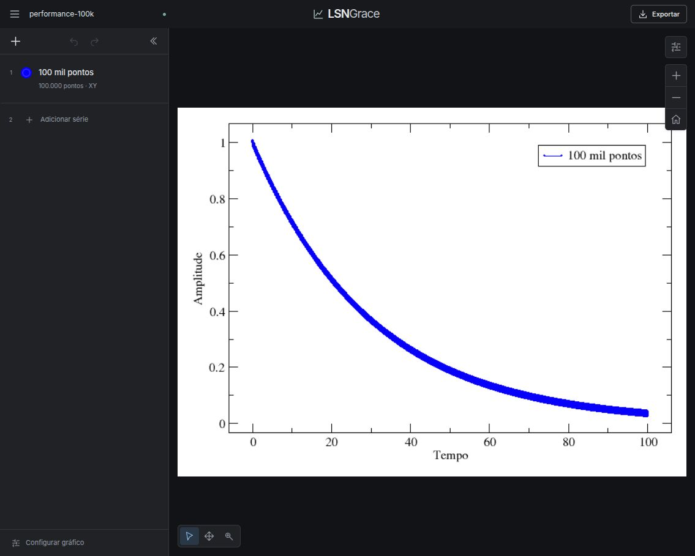

# Gargalos de desempenho: diagnóstico e correções

Medições locais em 23/11/2026, Node 24 e Grace 5.1.25. Foram usados os mesmos cenários e o mesmo benchmark antes e depois. Não são medições de FPS nem tempos completos de interação no navegador.

## Resultados

Medianas de cinco chamadas, em milissegundos. A carga inicial fica fora da medição; operações repetidas podem reutilizar os blocos de dados congelados. As primeiras validações, serializações e geometrias ainda percorrem os dados. O tempo nativo é de uma primeira chamada, incluindo a ponte e o processo Grace; ele varia mais com I/O e escalonamento.

| Pontos  | Editar título antes → depois | Serializar AGR antes → depois | Codificar para Grace antes → depois | Geometria de clique repetida antes → depois |
| ------- | ---------------------------- | ----------------------------- | ----------------------------------- | ------------------------------------------- |
| 208     | 0,46 → 0,18                  | 0,39 → 0,37                   | 2,33 → 0,03                         | 0,20 → <0,01                                |
| 10.000  | 10,58 → 0,15                 | 7,83 → 0,57                   | 40,29 → 0,46                        | 8,93 → 0,01                                 |
| 100.000 | 106,79 → 0,08                | 66,25 → 2,14                  | 298,05 → 3,50                       | 49,51 → <0,01                               |

O pipeline nativo do cenário sem símbolos passou de 397,10 para 205,08 ms em 100 mil pontos, mas o desenho do Grace continua tendo custo próprio. O ajuste automático de 100 mil pontos, depois da introdução de Immer, caiu de 246,70 para 22,04 ms ao ler um snapshot dos dados em vez de criar um proxy para cada amostra; essa é uma medição isolada da correção subsequente.

Resultados brutos: [antes](performance-before.json), [depois](performance-after.json). Reprodução: `npm run benchmark -- artifacts/performance-local.json` (requer `gracebat`). Os tempos variam conforme a máquina e a carga.

## Gargalos corrigidos

- **Cópias integrais por edição e histórico:** `structuredClone` duplicava todos os pontos para mudar apenas um título ou uma cor. Immer preserva referências dos ramos inalterados. O teste com vinte revisões verifica que todos os snapshots compartilham o mesmo bloco de pontos; a edição de um ponto copia apenas a linha afetada e o array que a contém.
- **Varreduras repetidas:** validação, serialização AGR, salvamento JSON e trajetórias de seleção reutilizam dados profundamente congelados. Objetos mutáveis e mudanças no tipo de dataset são novamente validados. Zoom, inversão e alterações numéricas invalidam a geometria correspondente.
- **Codificação por caractere:** o backend alocava arrays e objetos para cada caractere, inclusive milhões de dígitos ASCII. A nova passagem traduz apenas caracteres não ASCII, mantendo Latin-1, grego/Symbol, pontuação e rejeição de caracteres incompatíveis.
- **DOM e trabalho repetido no canvas:** o documento nativo fica memoizado; arrastar ou selecionar não reinsere seu DOM. A camada de seleção usa uma trajetória por série, inclusive em séries de pontos desconectados. Figuras com 100 mil pontos visíveis usam o driver PNG do Grace na prévia; os exports vetoriais continuam nativos e completos.
- **Reprocessamento e fila:** caches com limites de memória reaproveitam saídas de revisões anteriores. O backend permite dois processos simultâneos, enfileira bursts normais e remove pedidos cancelados. A espera mínima por edição caiu de 180 para 60 ms, e a roda de zoom acumula mudanças enquanto a prévia está pendente.
- **Salvamento competindo com edição:** gravação após pausa e em período ocioso quando disponível, com serialização reutilizada dos números e gravação final em `pagehide`.

## Conferência de 100 mil símbolos

Um projeto separado com 100.000 pontos e símbolos circulares foi aberto na interface. A saída SVG nativa tinha 7.042.690 bytes; o PNG de prévia, 6.536 bytes. O driver PNG levou 554 ms na primeira geração desse cenário, contra 354 ms para produzir SVG: a vantagem da prévia é reduzir transferência, parsing e DOM no navegador, sem prometer acelerar o rasterizador nativo. Pedidos idênticos com cache levaram aproximadamente 2–4 ms na ponte.

Na interface, o desenho passou a usar dois elementos (`svg` e `image`) e a camada interativa tinha 14 elementos. No modo “somente pontos”, a seleção continuou com uma única trajetória contendo 100 mil movimentos desconectados, sem cem mil círculos DOM. Nenhum ponto foi descartado.

Foram conferidos três zooms consecutivos, três ações de desfazer e refazer, ajuste automático, seleção e troca entre linhas e pontos. Refazer reaproveitou a mesma imagem já renderizada. O AGR salvo pelo Grace foi reaberto e manteve 100.000 pontos. A sessão de teste usou `localhost`, com armazenamento separado da sessão existente em `127.0.0.1`.

## Regressões

- `npm test`: 58 testes passaram, incluindo imutabilidade, histórico, atualização numérica, invalidação dos caches, rascunhos, filas e cancelamento.
- `npm run test:native`: formatos nativos, precisão, avisos, comandos externos e três renderizações concorrentes.
- `npm run build`: TypeScript e pacote de produção.
- `npm run format:check`: formatação.

O carregamento inicial e o primeiro desenho continuam proporcionais ao volume de dados. Para prévias densas, a resolução segue o padrão do driver PNG; SVG e EPS exportados preservam o vetor. O histórico permanece em memória e sem limite de revisões, compartilhando os dados inalterados.
