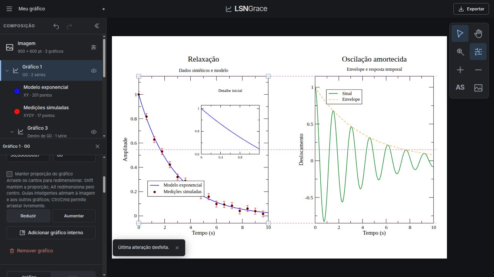

# Guias inteligentes no redimensionamento

Verificação em 24/11/2026.

As guias antes eram aplicadas à legenda. Agora o arraste dos cantos e os botões Aumentar/Reduzir compartilham um cálculo de encaixe para a área do gráfico.

- Referências: bordas e centros da imagem e dos demais gráficos visíveis.
- Tolerância de 6 pixels de tela, convertida para pontos da página.
- O canto oposto, ou o centro com Alt, permanece fixo. Com proporção travada, um único fator ajusta os dois lados.
- Gráficos internos que acompanham o resize e gráficos ocultos não atraem o gráfico selecionado.
- Ctrl/Cmd desativa encaixe e guias durante o arraste. As guias da legenda continuam com Alt para posicionamento livre.
- As linhas desenhadas correspondem aos alinhamentos reais após o encaixe. Depois de soltar ou clicar nos botões, ficam visíveis por 1,6 segundo; outras edições invalidam esse retorno visual.
- Cliques sucessivos continuam aumentando ou reduzindo: uma referência já alinhada não trava o progresso do botão.
- A geometria é confirmada na mesma operação de histórico que transforma os gráficos internos e as legendas view. As guias são estado temporário da interface e não são exportadas no AGR.

## Verificação

A suíte tem 95 testes, incluindo encaixe de bordas, tolerância, proporção, centro fixo, exclusão de gráficos internos/ocultos, posicionamento livre, imutabilidade e progresso em cliques repetidos.

No navegador, com a imagem de exemplo de 900 × 600 pt:

- Aumentar mostrou a guia de centro entre os dois painéis, em Y = 306 pt.
- Um arraste do canto superior direito, próximo ao segundo gráfico, encaixou a borda em X = 546 pt e o topo em Y = 108 pt. As duas guias foram medidas no SVG da interface.
- Após desfazer esse arraste e usar Reduzir, a área voltou para 348 × 396 pt, com três guias horizontais alinhadas ao segundo painel (topo, centro e base).

Build TypeScript/Vite e formatação verificados. O teste do navegador usou localhost, sem modificar o rascunho da origem 127.0.0.1.

