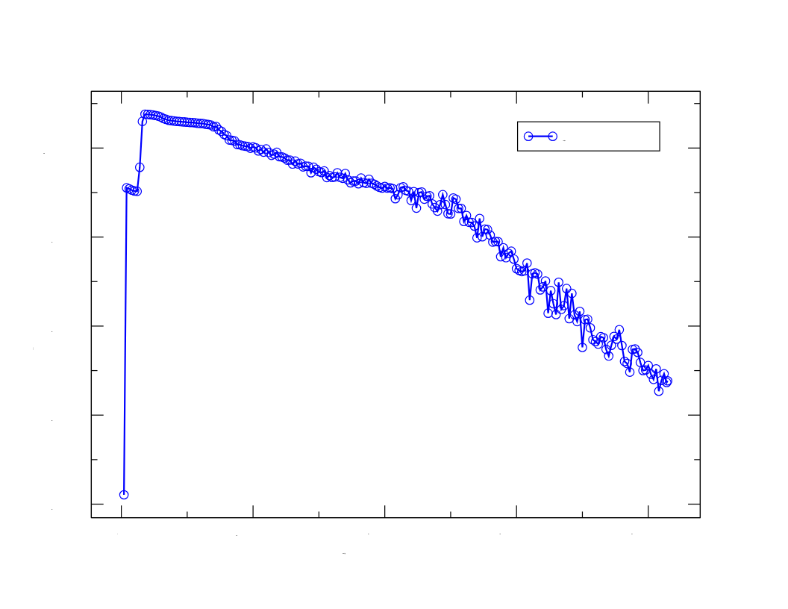
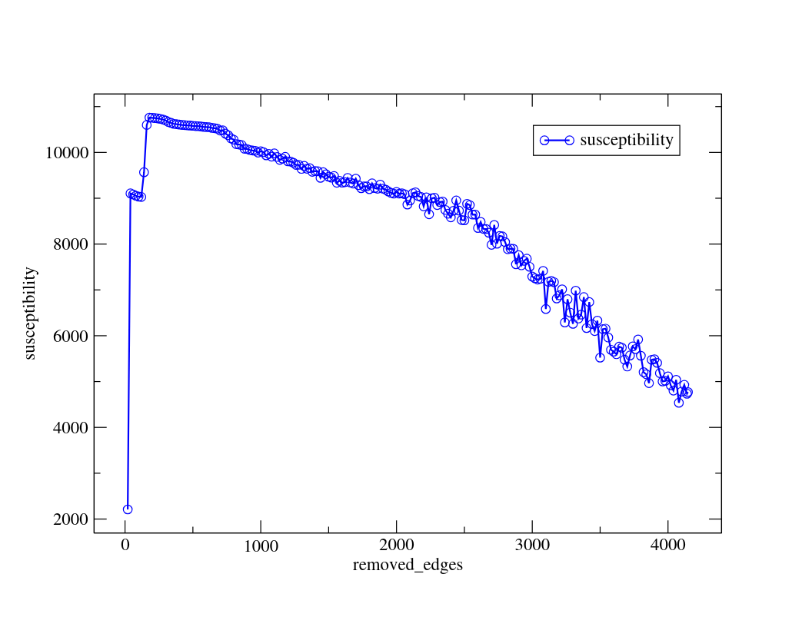
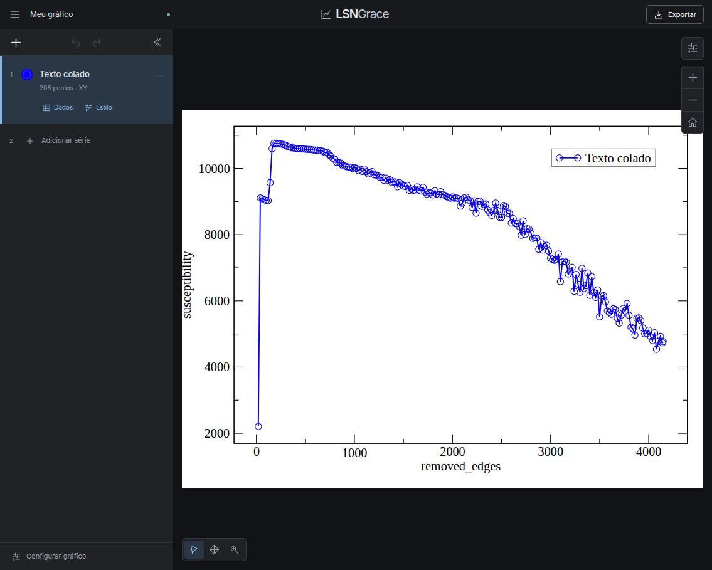

# Regressão: CSV de suscetibilidade e textos ausentes

Validação de 23/11/2026 com o arquivo original enviado pelo usuário, preservado em `tests/fixtures/susceptibility.csv` (CSV com cabeçalho e CRLF).

## Dados e limites

| Verificação                        | Resultado                                                   |
| ---------------------------------- | ----------------------------------------------------------- |
| Cabeçalhos                         | `removed_edges`, `susceptibility`                           |
| Colunas                            | X = primeira, Y = segunda; XY, sem incertezas               |
| Pares numéricos                    | 208; comparação independente dos 416 números passou         |
| X mínimo / máximo                  | 20 / 4147; estritamente crescente                           |
| Y mínimo / máximo                  | 2209.516416531108 / 10760.396870411329                      |
| Primeiro par                       | (20, 2209.516416531108)                                     |
| Segundo par                        | (40, 9106.0208717108)                                       |
| Limites X com autoscale            | -227.62 a 4394.62                                           |
| Limites Y com autoscale            | 1696.4635893 a 11273.4496976                                |
| Intervalos principais X / Y        | 1000 / 2000                                                 |
| Parser → mapeamento → AGR → parser | Todos os valores iguais aos números JavaScript de entrada   |
| Round-trip pelo Grace 5.1.25       | 208 pares; maior diferença absoluta: 1.8189894035458565e-12 |

O salto inicial e as oscilações posteriores pertencem aos dados. Não houve suavização, reordenação ou remoção de pontos.

## Falhas reproduzidas e correções

1. **Textos invisíveis no Firefox.** O driver SVG original emite `style="font-size:612.0000"`, com uma matriz de escala de aproximadamente 0.028. O Chromium aceita esse tamanho, mas o Firefox usado na verificação ignora a declaração sem unidade e reduz a fonte herdada a tamanho quase invisível. Acrescentar `px` à declaração resolve tanto a prévia quanto o SVG exportado. O [padrão SVG explica a exigência de unidades em comprimentos CSS no atributo style](https://www.w3.org/TR/SVG11/coords.html#Units). Os SVGs antes/depois são idênticos removendo apenas esses sufixos `px`; coordenadas, matrizes e trajetórias permanecem iguais.
2. **Faixa verde sobre a curva selecionada.** A camada de interação pintava uma trajetória verde com largura 8 e opacidade 0.25. Agora ela é transparente, mantendo a área de clique. A seleção permanece indicada na lista de séries.

O mesmo SVG foi aberto em um perfil temporário isolado do Firefox antes/depois. A captura anterior reproduz os textos minúsculos; a posterior recupera os números, eixos e legenda:

## Verificação na aplicação

Importação do arquivo original pelo seletor da interface, prévia com 208 pontos, criação da curva e seleção na lista, em `http://localhost:1420/`, com armazenamento separado da sessão em `127.0.0.1`. Após a correção, os 13 elementos de texto têm dimensões visíveis; a trajetória de interação selecionada continua com `pointer-events="stroke"` e `stroke="transparent"`. Nenhum alerta de erro.

## Comandos de regressão

- `npm test`: 49 testes passaram, incluindo o CSV real e a normalização SVG.
- `npm run test:native`: SVG, PNG, EPS e AGR produzidos pelo Grace real; CSV informado sem avisos, 13 textos SVG com unidades explícitas e dados preservados dentro de quatro epsilons de máquina.
- `npm run build`: TypeScript e build de produção passaram.
- `npm run format:check`: formatação verificada.

A regressão automatizada exige os textos esperados e unidades explícitas. A comparação visual entre motores foi realizada manualmente nesta validação, sem acrescentar o Firefox como dependência do projeto.
