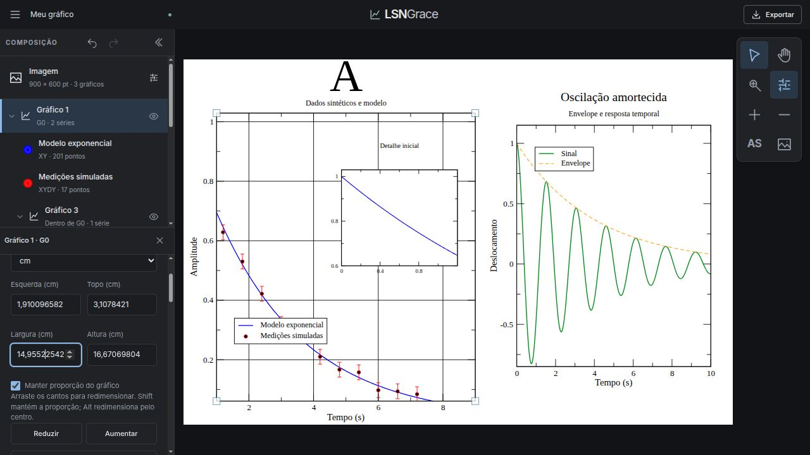

# Fontes, unidades e redimensionamento

Verificação em 24/11/2026, Grace 5.1.25.

## Problema reproduzido

O título tinha teto de 3× e os demais controles tipográficos de 5×. O arraste de cantos convertia a posição absoluta do cursor e arredondava o viewport para centésimos da menor dimensão da página. Em uma página de 900 × 600 pt, isso gerava passos de 6 pt, independentemente da escala de tela.

No navegador, um arraste de 3 px na horizontal e 2 px na vertical mudou a largura de 348 para 354 pt e deixou a altura em 396 pt: perdeu o movimento vertical e exagerou o horizontal. A guia também usava o retângulo entre o início e o fim do cursor, em vez do novo viewport inteiro. Em um único gráfico, a câmera podia reenquadrar a figura após redimensionar, compensando visualmente o aumento.

## Correção

- Campos tipográficos sem máximo artificial, com unidades pt, px, cm, mm, in, % e Grace. Valores devem ser finitos e não negativos.
- Unidade da imagem e do gráfico com conversão para a geometria nativa; o documento AGR continua sendo a fonte do estado.
- px usa 96 px por polegada; a imagem e o gráfico são medidos na publicação, não no tamanho aparente do monitor.
- % da fonte usa 1× Grace como base; % da imagem usa as dimensões existentes ao selecionar essa unidade; % do gráfico usa as dimensões da imagem.
- Resize pelo deslocamento relativo, sem o arredondamento antigo. O canto oposto fica fixo; cruzá-lo mantém uma dimensão mínima de 2 pt, sem inverter os limites.
- Alças com 11 pixels de tela, cursores diagonais, contorno do viewport proposto e indicação das dimensões durante o arraste.
- Proporção opcional nos campos e no arraste; Shift mantém a proporção e Alt usa o centro como âncora. Escape cancela; soltar registra uma operação de Undo.
- A câmera mostra a página completa durante a edição de propriedades, mantendo uma referência estável.
- Botões Aumentar/Reduzir na posição do gráfico alteram a área com fator 1,1 e seu inverso, mantendo o centro. O zoom do canvas altera apenas world. A camada temporária de zoom passou a incluir grades e barras dos eixos.

## Evidências

- **87 testes aprovados**, incluindo conversões físicas e percentuais, fontes grandes e round-trip AGR, deltas subponto nos quatro cantos, canto oposto fixo, prevenção de inversão, Shift/Alt e preservação de dados e gráficos internos.
- **Grace nativo:** título de 64 pt e legenda de 100 pt exportados sem avisos e medidos pela combinação de font-size e matriz no SVG. A integração anterior para SVG/PNG/EPS/AGR também passou.
- **Precisão no navegador:** em uma página com largura de 900 pt exibida em 868 px, um deslocamento de 3 × 2 px produziu exatamente 3,110599078 × 2,073770049 pt. O viewBox permaneceu `0 0 900 600`.
- A conversão da fonte de **100 px → 75 pt → 446,4285714%** não mudou o texto; o SVG confirmou 600 × 0,125 = 75 pt. O campo não tem atributo max.
- A largura da imagem de 900 pt foi mostrada como 31,75 cm. Em %, com proporção travada, 120% gerou 1080 × 720 pt. Desfazer restaurou 900 × 600 pt.
- Aumentar a área multiplicou largura e altura por 1,1, mantendo o intervalo X em [0, 10]. No zoom, X mudou para [1, 9], mantendo a área do gráfico.
- Arraste com proporção travada manteve a razão em 0,8970965332236135 (diferença apenas de ponto flutuante).
- Build TypeScript/Vite e formatação aprovados. O teste usou localhost, separado do rascunho em 127.0.0.1.

