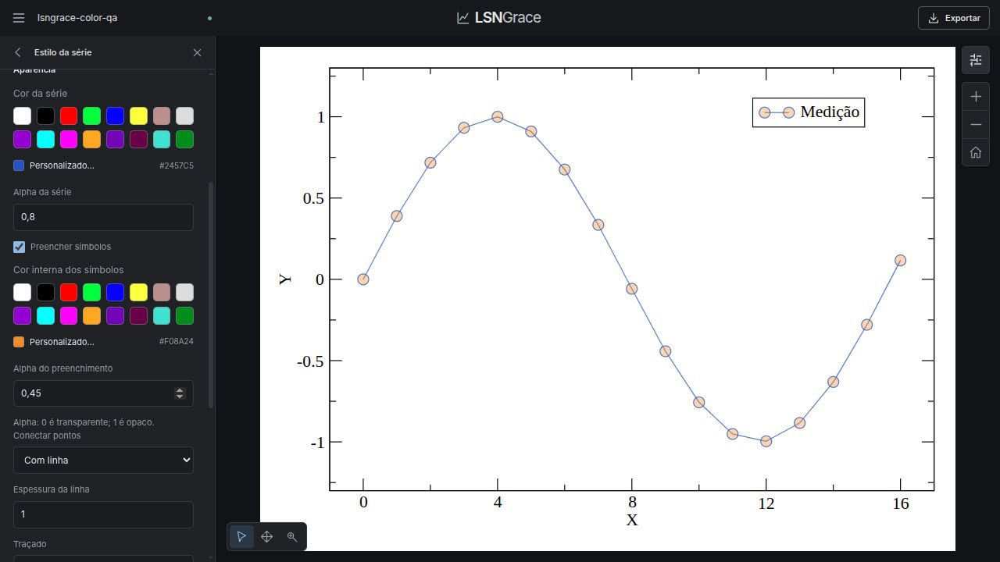

# Zoom imediato, cores e alpha

## Zoom

A resposta visual de zoom in/out usa uma camada Canvas2D temporária durante alterações de coordenadas. A roda acumula eventos em uma atualização por frame, normalizando deltas de mouse e trackpad. A camada de seleção deixa de construir trajetórias enquanto o motor está pendente. O desenho definitivo e as exportações continuam usando o Grace original.

Séries densas usam até 2.400 amostras apenas durante o gesto, preservando extremos locais, primeiro e último ponto e ordem de entrada. O documento e os exports mantêm todos os pontos. A prévia não se aplica a tipos de dataset ou estilos que ela não suporta, anotações e textos ricos; nesses casos permanece o fluxo nativo. Não há promessa de FPS constante em qualquer dispositivo.

Na validação em navegador com 100.000 pontos, após clicar em ampliar, a camada interativa já estava presente enquanto a requisição nativa estava pendente. Nenhuma trajetória cara de seleção foi construída nessa fase. Ampliar e afastar não bloquearam o próximo comando.

## Aparência

As duas paletas mostram as 16 cores clássicas com amostras visuais, identificação por nome e seleção marcada. “Personalizado…” oferece seletor e edição hexadecimal. Cores RGB existentes são reutilizadas; criar uma cor não altera outras séries que usam a paleta.

- Cor da série: linha, borda dos símbolos e barras de erro.
- Preencher símbolos: habilita o preenchimento, conservando a cor e alpha escolhidos ao desligar e religar.
- Cor interna dos símbolos: independente da cor da série.
- Alpha da série e do preenchimento: valores de 0 a 1. A opacidade efetiva do interior é o produto dos dois valores.

## Transparência e formatos

O Grace gera a geometria original. Para SVG com alpha, tintas temporárias identificam os elementos de cada componente, e recebem de volta a cor RGB real e a opacidade correspondente. Isso evita alterar eixos ou curvas opacas da mesma cor. PNG com alpha rasteriza esse SVG com resvg; figuras sem alpha continuam usando o driver PNG do Grace.

O `.agr` conserva alpha nos comentários `# LSNGrace alpha G0.S0 <série> <preenchimento>`, recuperados pelo parser do LSNGrace. O xmgrace clássico ignora esses comentários e mostra cores opacas, pois não oferece alpha. EPS compõe as cores sobre o fundo da página e informa essa limitação na exportação. As mensagens de exportação exibem o aviso real, sem confundi-lo com corte de página.

## Conferências

- 62 testes passaram: paleta, RGB customizado, round-trip do alpha, isolamento das tintas e preservação dos dados na prévia.
- `npm run test:native`: SVG, PNG, AGR e EPS reais, opacidade independente e avisos de compatibilidade.
- Conferência de pixel: azul com alpha efetivo 0,2 sobre branco produziu RGB `(204, 204, 255)` no centro do símbolo do PNG, com 1056 × 816 pixels.
- Navegador: cor da série `#2457C5`, interior `#F08A24`, alpha da série `0,8`, alpha interno `0,45`; preenchimento desligado/religado manteve os ajustes. SVG exibiu `stroke-opacity:0.8` e `fill-opacity:0.36` (com a representação normal de ponto flutuante).
- O teste adicional de download automatizado no navegador foi interrompido pela ferramenta. Os formatos foram verificados diretamente pela ponte nativa, sem depender desse download.

